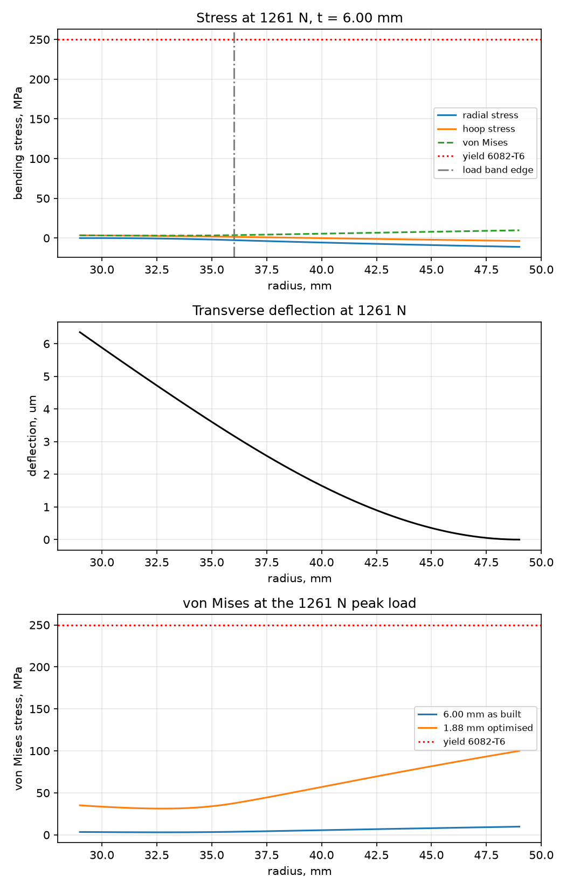

# Rocket Thrust-plate Analytical Optimisation

> Stress and deflection solver for the annular thrust plate of a high-power rocket, used to size the thickness of the plate for the required safety factor.

## Problem

A flat aluminium annulus (Al 6082-T6) is loaded on its inner top band by motor thrust transmitted through a bracket, and is clamped by epoxy over its outer band at the top and bottom. The inner and outer edges are free. Features on the plate such as holes are ignored for a simplified solution but taken into account within the 2.5x safety margin.

| Property | Value |
| :---- | :---- |
| Plate outer diameter | 110 mm |
| Bore diameter | 58 mm |
| Thickness as built | 6 mm |
| Load annulus | radius 29 - 36 mm |
| Clamped band | radius 43 - 55 mm |
| Clamp radius used | 49 mm |
| Peak thrust | 1261 N |
| Yield Stress | 250 MPa |
| Safety factor required | 2.5 |
| Allowable peak stress | 100 MPa |

## Method

The following assumptions are made:
- Thin plate theory
- Small deflections
- Uniform pressure
- Elastic region
- Isotropic material

The basis of the calculations start with *Kirchoff-Love thin plate theory for axisymmetric bending* which states:

$$D \nabla^4 w = q(r)$$

Where $`D`$ is the stiffness of the sheet, $`\nabla^4`$ is the biharmonic operator, $`w`$ is the deflection with respect to the radius and $`q`$ is the applied pressure.

The stiffness $`D`$ is:

$$D = \frac{E t^3}{12(1-\nu^2)}$$

Where $`E`$ is the Yung's modulus, $`t`$ is the thickness, and $`\nu`$ is the Poisson's ratio.

The model is then split into two regions, one where the load is applied, and the other where it is not.
The deflection is the sum of the homogeneous and particular solution, meaning, the scenario when there is no load, and when the load is applied respectively. Therefore the solution for the deflection $`w`$ at the homogeneous region becomes:

$$w(r) = C_1 + C_2 r^2 + C_3 \ln(r) + C_4 r^2 \ln(r)$$

And at the particular region is:

$$w(r) = C_5 + C_6 r^2 + C_7 \ln(r) + C_8 r^2 \ln(r) + \frac{q r^4}{64D}$$

The last term represents the particular solution and the rest is the homogeneous one. The homogeneous solution has 4 unknown coefficients $`C_1-C_4`$, however it must be solved for both regions, resulting in 8 unknowns.

At the inner free edge the bending moment and shear force is zero; and at the outer edge, the deflection and slope is zero. With that we can get 4 unknowns.

The other 4 uknowns are found by equating the unknowns of both regions at their contact point since all variables must be continuous.

With that the solution can be found by solving the 8x8 matrix.

To calculate the safety margins the stresses need to be calculated, and the Von-Misses stress is calculated from the radial ($`\sigma_r`$) and hoop  ($`\sigma_\theta`$) stresses.

$$\sigma_v = \sqrt{\sigma_r^2 - \sigma_r \sigma_\theta + \sigma_\theta^2}$$

The stress is calculated as:
$$\sigma = 6M/t^2$$

Which means that the thickness can be directly found using:
$$t_{\text{new}} = t_{\text{old}} \times \sqrt{\frac{\sigma_{\text{peak}}}{\sigma_{\text{allowed}}}}$$

## Results

The optimization reduces the thickness and mass by 68.7% whilst still preserving a 2.5 safety factor. This change would enable approximately an additional **91 g** on the payload of the rocket if it were to be applied to both stages.

| Quantity | Original | Optimized |
| :---- | :---- | :---- |
| Thickness | 6.00 mm | 1.88 mm | 
| Peak von Mises stress | 9.78 MPa | 100.00 MPa |
| Maximum deflection | 6.35 um | 207.72 um |
| Safety factor (yield) | 25.60 | 2.50 |
| Plate mass | 111.15 g | 34.76 g |
| Absolute Mass savings | - | 76.39 g |
| Relative Mass savings | - | **68.7%** |

